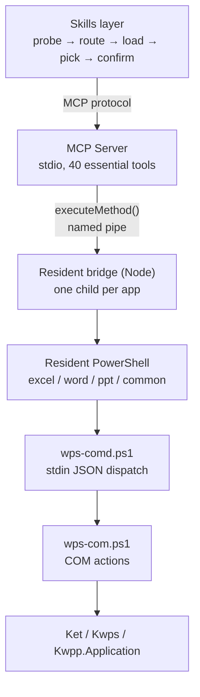

# WPS Office Multitool MCP

[简体中文](README.md) | **English**

<!-- AUTO:badges:start -->
[](https://github.com/forkgo430/wps-multitool-mcp/actions/workflows/ci.yml) [](LICENSE) [](https://www.npmjs.com/package/wps-multitool-mcp) [](https://github.com/forkgo430/wps-multitool-mcp/releases) [](#capabilities) [](#requirements)
<!-- AUTO:badges:end -->

> Let AI drive the WPS Office windows **you already have open**.

<sub>Author & maintainer: **赢容** · [npm](https://www.npmjs.com/package/wps-multitool-mcp) · [Release](https://github.com/forkgo430/wps-multitool-mcp/releases)</sub>

## 30-second setup

```powershell
npx -y wps-multitool-mcp
```

```json
{
  "mcpServers": {
    "wps-multitool-mcp": {
      "command": "npx",
      "args": ["-y", "wps-multitool-mcp"]
    }
  }
}
```

Restart your client, open a WPS document, then just ask:

> Bold the payment clause and append a risk note at the end

Want the in-WPS panel (snapshots / undo / status)? Install the add-in:

```powershell
irm https://cdn.jsdelivr.net/gh/forkgo430/wps-multitool-mcp@main/scripts/install.ps1 | iex
```

## Why not "just another WPS plugin"

| Problem | Mechanism |
|---|---|
| Hundreds of tools blow up the context | Essential tier only; the rest via `wps_search_tools` + `wps_load_tool_group` |
| Writes fail halfway and nobody can say what changed | `warnings` as a third state: done, but N things didn't land |
| Look-alike tools silently edit the wrong place | Every tool carries `notFor`; required reading in search results |
| A broken edit cannot be undone | Auto snapshot before risky writes (`wps_common_batch` built in) + operation log |
| No idea which tools actually work | Every tool carries its real-machine verification status; the default tier only lists verified ones |

COM is not transactional, so failures carry a retry tag: `[retryable]` resend freely,
`[do-not-retry · possibly half-applied]` read back first.

## Who it's for

**Use it if** you work in WPS on Windows and want to edit the document that is *already open*.

- WPS Writer / Spreadsheets / Presentation is your daily driver (contracts, papers, reports, decks)
- The target is the file in front of you — with its comments, tracked changes, headers, unsaved edits
- You need the Chinese-language details: academic layout, tracked revisions, template filling, TOC and cross-references
- You accept that an AI can be wrong, so you want it to snapshot before it writes

**Skip it if** — these are not "missing features", they are the wrong tool.

- macOS / Linux: this path is Windows COM; there is no port planned
- Headless CI / servers: it needs an interactive desktop and a logged-in session with WPS running
- Batch processing thousands of files: that is a job for file-level libraries (`python-docx` / `openpyxl`)
- Read-only extraction: if you don't need the app open, a parser is faster and safer

**WPS only, no MS Office** — a trade-off, not an oversight. WPS and Office are two different COM object
models (`Ket/Kwps/Kwpp` vs `Excel/Word/PowerPoint`). Supporting both means writing every action twice and
verifying it in two environments — double the maintenance for a fraction of the users. Everything here is
tuned for WPS users (Chinese document conventions, revisions, academic layout). Rather than being mediocre
on both sides, we go deep on one. For MS Office there are dedicated Excel/PPT MCP servers — pick the right one.

## Scale

<!-- AUTO:tool-stats:start -->
- **291 tools** (8 built-in + 283 specialized); **only 40 listed by default** (essential ∩ live-verified, load on demand — see `scripts/manual/basic-tier-verify.js`)
- Distribution (by tool group, built-ins counted in their app group): Common 27 (incl. core) / Word 67 / Excel 89 / PPT 108
- Annotations (measured): read-only 51 / destructive 34 / non-idempotent 110 — coverage 291/291
<!-- AUTO:tool-stats:end -->

## Architecture



~5 s cold start, then 2–3 ms per call. One process per app, so a stuck Writer never blocks Spreadsheets.

## Capabilities

Counts are generated from the live registry by `scripts/manual/gen-doc-stats.js` — do not edit by hand (CI enforces a diff gate).
Same scope as the stats block above: built-in tools are counted inside their app group (core inside Common), so the "Built-in" row is not additive.

<!-- AUTO:tool-table:start -->
| App | Tools | Highlights |
|-----|-------|-----------|
| Excel | 89 | formulas, data, charts, pivot tables, sheets, formatting, workbooks, rows/columns, comments & protection, image export |
| Word | 67 | formatting, content, document management, headers/footers, comments, bookmarks, tables, templates, academic layout, revisions, index, cross-references |
| PPT | 108 | slides, shapes, images, tables, beautify, animations, charts, 3D, data viz, image export |
| Common | 27 | save, connection check, text selection, format conversion, tool groups, intent routing, batch |
| Built-in | 8 (already counted above) | connection check, generic method, data cache |
<!-- AUTO:tool-table:end -->

The full list of all 306 tools (name / default tier / annotations / live-verification status) is in **[TOOLS.md](TOOLS.md)** — generated from the registry, so it can never drift from the code.

## Install

<details>
<summary><b>Requirements</b></summary>

| Requirement | Notes |
|-------------|-------|
| Windows 10 / 11 | WPS COM automation is Windows-only |
| WPS Office 2019+ (tested 12.1) | Any drive |
| Node.js ≥ 18 | Build and run the server |
| An MCP client | Claude Code / Cursor / Codex CLI / CodeBuddy / WorkBuddy, etc. |

</details>

<details>
<summary><b>Full install (one-liner + add-in + skill)</b></summary>

```powershell
irm https://cdn.jsdelivr.net/gh/forkgo430/wps-multitool-mcp@main/scripts/install.ps1 | iex
```

Checks the environment → fetches the project → installs deps and builds → deploys the WPS add-in →
installs the skill → prints the MCP config. Restart WPS and your client afterwards.
Needs GitHub access; otherwise use the manual install.

</details>

<details>
<summary><b>Manual install</b></summary>

```bash
git clone https://github.com/forkgo430/wps-multitool-mcp.git
cd wps-multitool-mcp
powershell -ExecutionPolicy Bypass -File scripts/install.ps1
```

The script also takes `-DryRun` (check only), `-Dev` (symlink the add-in so source edits apply live),
and `-InstallDir`.

</details>

<details>
<summary><b>MCP config only (no add-in)</b></summary>

Don't hand-copy paths — let the program write them:

```powershell
node wps-multitool-mcp/dist/index.js install
```

It detects CodeBuddy / WorkBuddy / Codex / Claude Code / Cursor (only ones you already have — it never
creates a directory for you), backs up each config before writing, reads it back to verify, and restores
the backup if anything fails.

```powershell
node dist/index.js install --dry-run    # show what would change
node dist/index.js install --print      # print snippets, touch nothing
```

For clients it can't detect, it prints a ready-to-paste snippet.
Standard stdio server (spec 2025-11-25) — works with any MCP client.

</details>

## Privacy

- **Your documents never leave the machine**: no telemetry, no crash reporting, no usage analytics,
  and `src/` makes zero outbound requests
- The only local network endpoint is the bridge's read-only status server (`127.0.0.1:27731/status`,
  polled by the WPS task pane)
- Snapshots live in `~/.wps-multitool-mcp/snapshots/` — they are copies of your documents, treat that
  directory as sensitive and clear it after handling confidential files

See [SECURITY.md](SECURITY.md) for the full threat model.

## Troubleshooting

| Symptom | Fix |
|---------|-----|
| MCP fails to connect | Ensure `dist/index.js` exists and the client path is right |
| WPS not responding | Restart WPS; confirm `%APPDATA%\kingsoft\wps\jsaddons\wps-claude-addon_` exists |
| "arguments error" | Re-run `scripts/install.ps1`, restart WPS |
| One-liner hangs | No GitHub access; use the manual install |
| Anything else | [Open an issue](https://github.com/forkgo430/wps-multitool-mcp/issues) |

## License

MIT
