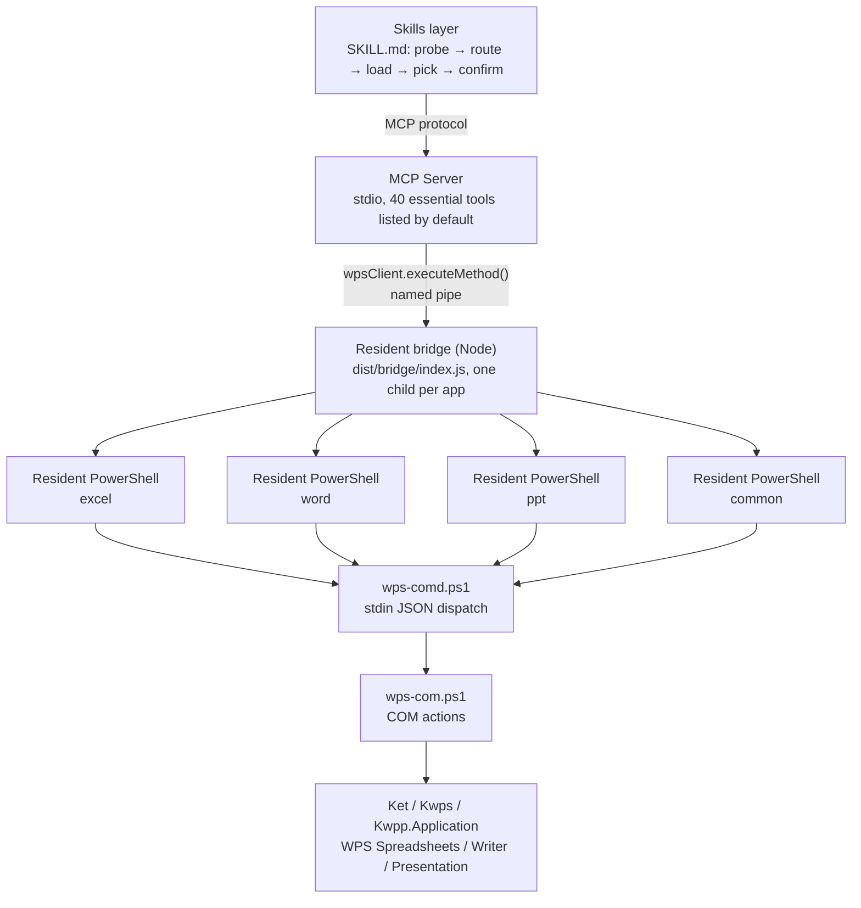

# WPS Office Multitool MCP

[简体中文](README.md) | **English**

<!-- AUTO:badges:start -->
[](https://github.com/forkgo430/wps-multitool-mcp/actions/workflows/ci.yml) [](LICENSE) [](CHANGELOG.md) [](#capabilities) [](#quick-start)
<!-- AUTO:badges:end -->

> Let AI drive the WPS Office windows **you already have open** — real COM edits, not simulated clicks.

WPS COM automation is capable, but handing it straight to a model hits three walls: hundreds of tools blow up the context,
half-finished writes cannot be described honestly, and look-alike tools silently edit the wrong place.
This MCP turns those into **mechanisms**: only 40 tools listed by default, failures carry a retryability tag,
and every tool exposes machine-readable read/write annotations.

## Contents

- [Quick start](#quick-start) · [Requirements](#requirements) · [What it does / doesn't](#what-it-does--doesnt)
- [At a glance](#at-a-glance-measured) · [Architecture](#architecture) · [Capabilities](#capabilities)
- [Design decisions](#design-decisions) · [Troubleshooting](#troubleshooting) · [License](#license)

## Quick start

**One command** (needs GitHub access; use a proxy if you're behind the GFW):

```powershell
irm https://cdn.jsdelivr.net/gh/forkgo430/wps-multitool-mcp@main/scripts/install.ps1 | iex
```

It will: check the environment → fetch the project → install deps and build → deploy the WPS add-in → install the skill →
print the MCP config. Then **restart WPS and your AI client** and paste the printed config into your client.

<details>
<summary><b>Manual install (restricted network / want full control)</b></summary>

```bash
git clone https://github.com/forkgo430/wps-multitool-mcp.git
cd wps-multitool-mcp
powershell -ExecutionPolicy Bypass -File scripts/install.ps1
```

Same steps as the one-liner. `scripts/install.ps1` also accepts `-DryRun` (check only, change nothing)
and `-Dev` (deploy the add-in as a symlink so source edits apply immediately).

</details>

<details>
<summary><b>Configure MCP only (the add-in only affects the side panel inside WPS)</b></summary>

**Claude Code** — `~/.claude/settings.json`:

```json
{
  "mcpServers": {
    "wps-multitool-mcp": {
      "command": "node",
      "args": ["/your/path/wps-multitool-mcp/wps-office-mcp/dist/index.js"]
    }
  }
}
```

**Cursor** — `.cursor/mcp.json`; **OpenAI Codex CLI** — `~/.codex/config.toml`:

```toml
[mcp_servers.wps-multitool-mcp]
command = "node"
args = ["/your/path/wps-multitool-mcp/wps-office-mcp/dist/index.js"]
```

**Other MCP clients** — same `command` / `args`. Standard stdio server (spec 2025-11-25).

</details>

## Requirements

| Requirement | Notes |
|-------------|-------|
| **Windows 10 / 11** | WPS COM automation is Windows-only; no macOS / Linux build |
| **WPS Office 2019+** (tested on 12.1) | Required by both the add-in and the COM interface; any drive is fine |
| **Node.js ≥ 18** | Builds and runs the MCP server |
| **An MCP client** | Claude Code / Cursor / Codex CLI / CodeBuddy / WorkBuddy, etc. |
| Network | The one-liner needs GitHub access; otherwise use manual install |

## What it does / doesn't

| Does | Doesn't |
|------|---------|
| Read/write **currently open** WPS documents (Writer, Spreadsheets, Presentation) | Never touches cloud documents; if nothing is open it asks you to open one instead of spawning windows |
| Layout & formatting: styles, fonts, paragraphs, tables, charts, headers/footers, TOC | **No undo / rollback** — COM writes are not transactional; snapshot before big edits |
| Table data, formulas, pivot tables, conditional formatting, image export | **No automatic retry** — "never ran" and "ran halfway" are indistinguishable; failure tags say whether a retry is safe |
| Comments, bookmarks, revisions, cross-references, index, academic layout | Doesn't guarantee every COM property across every WPS version; unsupported bits surface as `warnings` |
| Small composed operations of 1–3 steps (`wps_common_batch`) | No long-running background jobs, no cross-machine control |

## At a glance (measured)

<!-- AUTO:tool-stats:start -->
- **306 tools** (12 built-in + 294 specialized); **only 40 listed by default** (essential tier, load on demand — see `scripts/manual/basic-tier-verify.js`)
- Distribution (by tool group, built-ins counted in their app group): Common 25 (incl. core) / Word 70 / Excel 95 / PPT 116
- Annotations (measured): read-only 53 / destructive 34 / non-idempotent 115 — coverage 306/306
<!-- AUTO:tool-stats:end -->

- Companion skill `wps-multitool`: encodes the default chain — probe → route → load group → pick with `notFor` → confirm before writing
  (source in `wps-office-mcp/skills/wps-multitool/`; the installer copies it into your client's skills directory)
- **Resident bridge**: ~5 s cold start, then 2–3 ms per call (one process per app, no head-of-line blocking)

## Architecture



## Capabilities

Counts are generated from the live registry by `scripts/manual/gen-doc-stats.js` — do not edit by hand (CI enforces a diff gate).
Same scope as the stats block above: built-in tools are counted inside their app group (core inside Common), so the "Built-in" row is not additive.

<!-- AUTO:tool-table:start -->
| App | Tools | Highlights |
|-----|-------|-----------|
| Excel | 95 | formulas, data, charts, pivot tables, sheets, formatting, workbooks, rows/columns, comments & protection, image export |
| Word | 70 | formatting, content, document management, headers/footers, comments, bookmarks, tables, templates, academic layout, revisions, index, cross-references |
| PPT | 116 | slides, shapes, images, tables, beautify, animations, charts, 3D, data viz, image export |
| Common | 25 | save, connection check, text selection, format conversion, tool groups, intent routing, batch |
| Built-in | 12 (already counted above) | connection check, generic method, data cache |
<!-- AUTO:tool-table:end -->

## Design decisions

These may look counter-intuitive, but each one exists to keep the model and the user out of a trap:

1. **Only 40 tools listed by default** — context is the scarcest resource. Dumping hundreds of tools in is expensive
   and dilutes attention; the rest are found via `wps_search_tools` and loaded via `wps_load_tool_group`.
   **"Tool not found" usually means the group is not loaded, not that the capability is missing.**
2. **"Partially succeeded" is a third state** — COM is not transactional and will naturally do half the work
   (a property refused, an anchor would not take). Calling it failed makes users redo everything; calling it success
   makes them think it is all done. So successful calls may carry `warnings`, rendered as
   "done, but N things did not land as expected".
3. **No automatic retry** — when "never executed" and "executed halfway" are indistinguishable, replaying means running twice.
   Failure text carries a bracketed tag: `[retryable]` may be retried with backoff, `[do-not-retry · possibly half-applied]`
   must be verified by reading back first.
4. **Look-alike tools must declare `notFor`** — this toolset has 6 `background` variants, 5 `animation` variants, 2 TOC tools…
   Picking the wrong one does not error, it silently edits somewhere else. That is why `notFor` in search results is required reading.

## Troubleshooting

| Symptom | Fix |
|---------|-----|
| MCP fails to connect | Ensure the build ran (`wps-office-mcp/dist/index.js` exists) and the client path is correct |
| WPS not responding | Restart WPS Office; confirm the add-in is installed (`%APPDATA%\kingsoft\wps\jsaddons\wps-claude-addon_`) |
| "arguments error" | Re-run `scripts/install.ps1`, then restart WPS |
| One-liner stuck downloading | GitHub unreachable; use a proxy or the manual install |
| Tool returns null | Make sure a document of that type is open in WPS |
| Anything else | Open an issue: https://github.com/forkgo430/wps-multitool-mcp/issues |

## License

MIT
