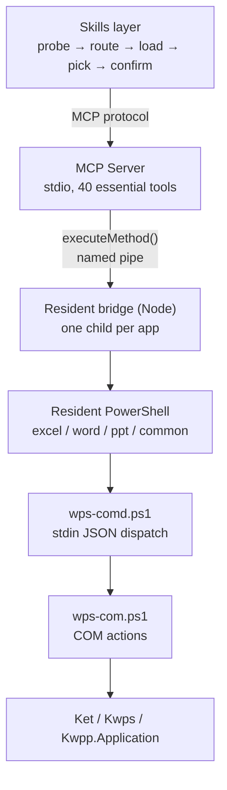

# WPS Office Multitool MCP

[简体中文](README.md) | **English**

<!-- AUTO:badges:start -->
[](https://github.com/forkgo430/wps-multitool-mcp/actions/workflows/ci.yml) [](LICENSE) [](https://www.npmjs.com/package/wps-multitool-mcp) [](https://github.com/forkgo430/wps-multitool-mcp/releases) [](#capabilities) [](#requirements)
<!-- AUTO:badges:end -->

> Let AI drive the WPS Office windows **you already have open**.

<sub>Author & maintainer: **赢容** · [npm](https://www.npmjs.com/package/wps-multitool-mcp) · [Release](https://github.com/forkgo430/wps-multitool-mcp/releases)</sub>

## 30-second setup

```powershell
npx -y wps-multitool-mcp
```

```json
{
  "mcpServers": {
    "wps-multitool-mcp": {
      "command": "npx",
      "args": ["-y", "wps-multitool-mcp"]
    }
  }
}
```

Restart your client, open a WPS document, then just ask:

> Bold the payment clause and append a risk note at the end

Want the in-WPS panel (snapshots / undo / status)? Install the add-in:

```powershell
irm https://cdn.jsdelivr.net/gh/forkgo430/wps-multitool-mcp@main/scripts/install.ps1 | iex
```

## Why not "just another WPS plugin"

| Problem | Mechanism |
|---|---|
| Hundreds of tools blow up the context | 40 listed by default; the rest via `wps_search_tools` + `wps_load_tool_group` |
| Writes fail halfway and nobody can say what changed | `warnings` as a third state: done, but N things didn't land |
| Look-alike tools silently edit the wrong place | Every tool carries `notFor`; required reading in search results |

COM is not transactional, so failures carry a retry tag: `[retryable]` resend freely,
`[do-not-retry · possibly half-applied]` read back first.

## Scale

<!-- AUTO:tool-stats:start -->
- **306 tools** (12 built-in + 294 specialized); **only 40 listed by default** (essential tier, load on demand — see `scripts/manual/basic-tier-verify.js`)
- Distribution (by tool group, built-ins counted in their app group): Common 25 (incl. core) / Word 70 / Excel 95 / PPT 116
- Annotations (measured): read-only 53 / destructive 34 / non-idempotent 115 — coverage 306/306
<!-- AUTO:tool-stats:end -->

## Architecture



~5 s cold start, then 2–3 ms per call. One process per app, so a stuck Writer never blocks Spreadsheets.

## Capabilities

Counts are generated from the live registry by `scripts/manual/gen-doc-stats.js` — do not edit by hand (CI enforces a diff gate).
Same scope as the stats block above: built-in tools are counted inside their app group (core inside Common), so the "Built-in" row is not additive.

<!-- AUTO:tool-table:start -->
| App | Tools | Highlights |
|-----|-------|-----------|
| Excel | 95 | formulas, data, charts, pivot tables, sheets, formatting, workbooks, rows/columns, comments & protection, image export |
| Word | 70 | formatting, content, document management, headers/footers, comments, bookmarks, tables, templates, academic layout, revisions, index, cross-references |
| PPT | 116 | slides, shapes, images, tables, beautify, animations, charts, 3D, data viz, image export |
| Common | 25 | save, connection check, text selection, format conversion, tool groups, intent routing, batch |
| Built-in | 12 (already counted above) | connection check, generic method, data cache |
<!-- AUTO:tool-table:end -->

## Install

<details>
<summary><b>Requirements</b></summary>

| Requirement | Notes |
|-------------|-------|
| Windows 10 / 11 | WPS COM automation is Windows-only |
| WPS Office 2019+ (tested 12.1) | Any drive |
| Node.js ≥ 18 | Build and run the server |
| An MCP client | Claude Code / Cursor / Codex CLI / CodeBuddy / WorkBuddy, etc. |

</details>

<details>
<summary><b>Full install (one-liner + add-in + skill)</b></summary>

```powershell
irm https://cdn.jsdelivr.net/gh/forkgo430/wps-multitool-mcp@main/scripts/install.ps1 | iex
```

Checks the environment → fetches the project → installs deps and builds → deploys the WPS add-in →
installs the skill → prints the MCP config. Restart WPS and your client afterwards.
Needs GitHub access; otherwise use the manual install.

</details>

<details>
<summary><b>Manual install</b></summary>

```bash
git clone https://github.com/forkgo430/wps-multitool-mcp.git
cd wps-multitool-mcp
powershell -ExecutionPolicy Bypass -File scripts/install.ps1
```

The script also takes `-DryRun` (check only), `-Dev` (symlink the add-in so source edits apply live),
and `-InstallDir`.

</details>

<details>
<summary><b>MCP config only (no add-in)</b></summary>

**Claude Code** — `~/.claude/settings.json`:

```json
{
  "mcpServers": {
    "wps-multitool-mcp": {
      "command": "node",
      "args": ["/your/path/wps-multitool-mcp/wps-office-mcp/dist/index.js"]
    }
  }
}
```

**Cursor** — `.cursor/mcp.json`; **OpenAI Codex CLI** — `~/.codex/config.toml`:

```toml
[mcp_servers.wps-multitool-mcp]
command = "node"
args = ["/your/path/wps-multitool-mcp/wps-office-mcp/dist/index.js"]
```

Standard stdio server (spec 2025-11-25) — works with any MCP client.

</details>

## Troubleshooting

| Symptom | Fix |
|---------|-----|
| MCP fails to connect | Ensure `dist/index.js` exists and the client path is right |
| WPS not responding | Restart WPS; confirm `%APPDATA%\kingsoft\wps\jsaddons\wps-claude-addon_` exists |
| "arguments error" | Re-run `scripts/install.ps1`, restart WPS |
| One-liner hangs | No GitHub access; use the manual install |
| Anything else | [Open an issue](https://github.com/forkgo430/wps-multitool-mcp/issues) |

## License

MIT
