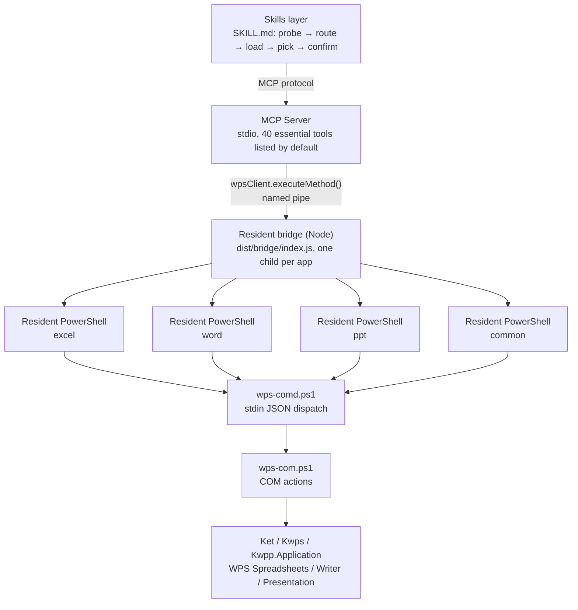

# WPS Office Multitool MCP

<!-- AUTO:badges:start -->
[](LICENSE) [](CHANGELOG.md) [](#capabilities) [](#quick-start)
<!-- AUTO:badges:end -->

[简体中文](README.md) | **English**

> Let AI drive the WPS Office windows **you already have open** — real COM edits, not simulated clicks.

WPS COM automation is capable, but handing it straight to a model hits three walls: hundreds of tools blow up the context,
half-finished writes cannot be described honestly, and look-alike tools silently edit the wrong place.
This MCP turns those into **mechanisms**: only 40 tools listed by default, failures carry a retryability tag,
and every tool exposes machine-readable read/write annotations.

## At a glance (measured)

<!-- AUTO:tool-stats:start -->
- **306 tools** (12 built-in + 294 specialized); **only 40 listed by default** (essential tier, load on demand — see `scripts/manual/basic-tier-verify.js`)
- Distribution (by tool group, built-ins counted in their app group): Common 25 (incl. core) / Word 70 / Excel 95 / PPT 116
- Annotations (measured): read-only 53 / destructive 34 / non-idempotent 115 — coverage 306/306
<!-- AUTO:tool-stats:end -->

- Companion skill `wps-multitool`: encodes the default chain — probe → route → load group → pick with `notFor` → confirm before writing
  (source in `wps-office-mcp/skills/wps-multitool/`)
- Windows only (WPS COM automation is Windows-only)
- **Resident bridge**: ~5 s cold start, then 2–3 ms per call (one process per app, no head-of-line blocking)

## Architecture



## Capabilities

Counts are generated from the live registry by `scripts/manual/gen-doc-stats.js` — do not edit by hand (CI enforces a diff gate).
Same scope as the stats block above: built-in tools are counted inside their app group (core inside Common), so the "Built-in" row is not additive.

<!-- AUTO:tool-table:start -->
| App | Tools | Highlights |
|-----|-------|-----------|
| Excel | 95 | formulas, data, charts, pivot tables, sheets, formatting, workbooks, rows/columns, comments & protection, image export |
| Word | 70 | formatting, content, document management, headers/footers, comments, bookmarks, tables, templates, academic layout, revisions, index, cross-references |
| PPT | 116 | slides, shapes, images, tables, beautify, animations, charts, 3D, data viz, image export |
| Common | 25 | save, connection check, text selection, format conversion, tool groups, intent routing, batch |
| Built-in | 12 (already counted above) | connection check, generic method, data cache |
<!-- AUTO:tool-table:end -->

## Quick start

<details>
<summary><b>6 steps (click to expand)</b></summary>

### Step 1: Clone

```bash
git clone https://github.com/forkgo430/wps-multitool-mcp.git
cd wps-multitool-mcp
```

### Step 2: Install dependencies and build

```bash
cd wps-office-mcp
npm install
npm run build
cd ..
```

### Step 3: Register the MCP server

Write the config below into the file for your client, replacing the path with the absolute path on your machine.

**Claude Code** — `~/.claude/settings.json`:

```json
{
  "mcpServers": {
    "wps-multitool-mcp": {
      "command": "node",
      "args": ["/your/path/wps-multitool-mcp/wps-office-mcp/dist/index.js"]
    }
  }
}
```

**Cursor** — `.cursor/mcp.json` in the project root:

```json
{
  "mcpServers": {
    "wps-multitool-mcp": {
      "command": "node",
      "args": ["/your/path/wps-multitool-mcp/wps-office-mcp/dist/index.js"]
    }
  }
}
```

**OpenAI Codex CLI** — `~/.codex/config.toml`:

```toml
[mcp_servers.wps-multitool-mcp]
command = "node"
args = ["/your/path/wps-multitool-mcp/wps-office-mcp/dist/index.js"]
```

Or: `codex mcp add wps-multitool-mcp -- node /your/path/wps-multitool-mcp/wps-office-mcp/dist/index.js`

**Other MCP-capable IDEs** — use the same `command` / `args`. This is a standard stdio server
(spec 2025-11-25) and works with any first-class MCP client (Claude Code / Cursor / Codex CLI / GitHub Copilot CLI / Windsurf).

### Step 4: Install the WPS add-in

⚠️ Manual step (an AI cannot click inside WPS):

```powershell
powershell -ExecutionPolicy Bypass -File scripts/install.ps1
```

⚠️ Restart WPS Office afterwards.

### Step 5: Install the skill (Claude Code only)

```bash
mkdir -p ~/.claude/skills
ln -sf "$(pwd)/wps-office-mcp/skills/wps-multitool" ~/.claude/skills/wps-multitool
```

### Step 6: Verify

```powershell
cd wps-office-mcp
npm run verify
# expect 14/14 gates green (includes real-machine Word/Excel capability probes)
```

</details>

## Design decisions

These may look counter-intuitive, but each one exists to keep the model and the user out of a trap:

1. **Only 40 tools listed by default** — context is the scarcest resource. Dumping hundreds of tools in is expensive
   and dilutes attention; the rest are found via `wps_search_tools` and loaded via `wps_load_tool_group`.
   **"Tool not found" usually means the group is not loaded, not that the capability is missing.**
2. **"Partially succeeded" is a third state** — COM is not transactional and will naturally do half the work
   (a property refused, an anchor would not take). Calling it failed makes users redo everything; calling it success
   makes them think it is all done. So successful calls may carry `warnings`, rendered as
   "done, but N things did not land as expected".
3. **No automatic retry** — when "never executed" and "executed halfway" are indistinguishable, replaying means running twice.
   Failure text carries a bracketed tag: `[retryable]` may be retried with backoff, `[do-not-retry · possibly half-applied]`
   must be verified by reading back first.
4. **Look-alike tools must declare `notFor`** — this toolset has 6 `background` variants, 5 `animation` variants, 2 TOC tools…
   Picking the wrong one does not error, it silently edits somewhere else. That is why `notFor` in search results is required reading.

## Troubleshooting

| Symptom | Fix |
|---------|-----|
| MCP fails to connect | Ensure `npm install && npm run build` ran; check `dist/index.js` exists |
| WPS not responding | Restart WPS Office; confirm the add-in is installed |
| "arguments error" | Re-run the install script, then restart WPS |
| No add-in on Linux | Windows only (WPS COM automation is Windows-only) |
| Tool returns null | Make sure a document of that type is open in WPS |
| Anything else | Open an issue: https://github.com/forkgo430/wps-multitool-mcp/issues |

## License

MIT
