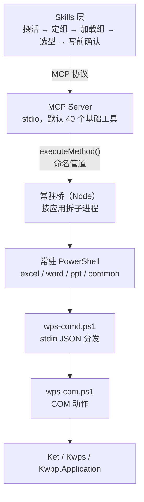

# WPS Office 多面手 MCP

**简体中文** | [English](README.en.md)

<!-- AUTO:badges:start -->
[](https://github.com/forkgo430/wps-multitool-mcp/actions/workflows/ci.yml) [](LICENSE) [](https://www.npmjs.com/package/wps-multitool-mcp) [](https://github.com/forkgo430/wps-multitool-mcp/releases) [](#能力一览) [](#安装)
<!-- AUTO:badges:end -->

> 让 AI 直接操控你正开着的 WPS 文字、表格、演示。
>
> 除了改，它也能生成。从空白页建一份带目录和图表的文稿；把表格里的数字变成图和透视表，
> 再贴进演示；整篇换字体、套主题；导出成图片和 PDF。
>
> **全需求全栈解决。** 三个应用、五个环节，任意一格都有工具接得住；接不住的还有
> `wps_execute_method` 直连 314 个底层动作。

| | 读 | 写 | 生成 | 排版 | 导出 |
|---|:--:|:--:|:--:|:--:|:--:|
| WPS 文字 | ✓ | ✓ | ✓ | ✓ | ✓ |
| WPS 表格 | ✓ | ✓ | ✓ | ✓ | ✓ |
| WPS 演示 | ✓ | ✓ | ✓ | ✓ | ✓ |

<sub>作者 / 维护者：**赢容** · [npm](https://www.npmjs.com/package/wps-multitool-mcp) · [Release](https://github.com/forkgo430/wps-multitool-mcp/releases)</sub>

## 30 秒上手

```powershell
npx -y wps-multitool-mcp
```

```json
{
  "mcpServers": {
    "wps-multitool-mcp": {
      "command": "npx",
      "args": ["-y", "wps-multitool-mcp"]
    }
  }
}
```

重启客户端，打开一个 WPS 文档，然后直接说：

> 把这份合同的金额段落加粗，并在末尾补一段风险提示

想要侧边面板（快照 / 撤销 / 状态），再装加载项：

```powershell
irm https://cdn.jsdelivr.net/gh/forkgo430/wps-multitool-mcp@main/scripts/install.ps1 | iex
```

<a id="能力一览"></a>

## 它能干什么

| 能做什么 | 怎么做到 |
|---|---|
| 从空白页做出一份成品 | 新建文稿、加页、写标题正文、套主题、加动画和切换、补页码，一条链走完 |
| 把表格数字变成汇报材料 | 表算完直接建图表或透视表，导出成图，贴进演示。省掉你复制粘贴那一步 |
| 演示里的结构件 | 时间轴、流程图、组织架构图、仪表盘、环形图、进度条、KPI 卡片、迷你图表、3D 文字、样式化表格，都有现成工具 |
| 整篇统一外观 | `beautify_all_slides` 套同一套风格，`unify_font` 统一字体，`auto_layout` 自动排版，`smart_distribute` 按间距分布 |
| 公文和论文的排版件 | 自动目录、书目索引、交叉引用、脚注、修订留痕、页眉页脚、按模板填字段 |
| 公式不止能写 | 能生成公式，也能诊断公式为什么报错。数组公式、透视表的建刷改查清都有 |
| 导出 | 演示单页出图，表格的图表和区域出图，格式转换，转 PDF |
| 批量执行带快照 | `wps_common_batch` 一次跑多步，碰上破坏性动作先存快照，事后能退回磁盘那一版 |

另外四个用起来省事的：

| 能力 | 说明 |
|---|---|
| 一句话定方向 | `wps_route_intent` 把"帮我做个汇报"映射到演示组。认不出来时它会说认不出来，让你换个说法，不随便挑一个 |
| 用中文搜工具 | `wps_search_tools` 直接中文搜，结果带 `notFor` 反例。六个 background、五个 animation 这种近名工具靠它分 |
| 工具自带安全标签 | 284 个都带 `readOnly` / `destructive` / `idempotent`。AI 能看出哪个会删东西、哪个重复跑结果一样 |
| 改名不砸旧调用 | 别名带参数映射。工具改名后旧名字照用，参数自动搬到新字段 |

<!-- AUTO:tool-table:start -->
| 应用 | 工具数 | 主要能力 |
|------|--------|---------|
| Excel | 89 | 公式/数据/图表/透视表/工作表/格式/工作簿/行列/批注保护/图片导出 |
| Word | 67 | 格式/内容/文档管理/页眉页脚/批注/书签/表格/模板填写/学术排版/修订/索引/交叉引用 |
| PPT | 101 | 幻灯片/形状/图片/表格/美化/动画/图表/3D/数据可视化/图片导出 |
| 通用 | 27 | 保存/连接检测/文本选取/格式转换/工具组管理/意图路由/批量执行 |
| 内置 | 8（已计入上方各组） | 连接检查/万能方法调用/数据缓存 |
<!-- AUTO:tool-table:end -->

计数由 `scripts/manual/gen-doc-stats.js` 从注册表生成，勿手改（CI 有 diff 门禁）。
口径与上方统计区一致：内置工具计入对应应用组（core 计入通用），故"内置"行不叠加。

全部 284 个工具的完整清单（名称 / 默认档 / 注解 / 真机验证状态）见 **[TOOLS.md](TOOLS.md)**，
它由注册表生成，与代码永远同步。另有 31 个旧名别名，调用时会自动解析到对应的新工具。

## 架构



冷启动约 5 秒，把常驻桥和四个常驻 PowerShell 拉起来。之后每次调用 2 到 3 毫秒。
MCP 和 WPS 之间走命名管道，不轮询 HTTP，也不是每次起一个脚本进程。
连着改二十处格式，付的是二十次两毫秒。

一个应用一个进程。文字那边卡死了，表格照样干活。

守卫基本只有一个落点：

| 守卫 | 落在哪 | 换来什么 |
|---|---|---|
| 动作出口 | `src/client/wps-client.ts:248` `execWpsAction` | 314 个 COM 动作全走这里，没有第二处直连 PowerShell |
| 快照、warnings、取消、错误前缀 | `tool-registry.ts:596`、`wps-client.ts:35`、`mcp-server.ts:158`、`mcp-server.ts:206` | `src/tools/**` 下这四个标识符各出现 0 次。工具从 284 涨到 500 也不会漏 |
| 取消信号 | `mcp-server.ts:158`（`AsyncLocalStorage`） | 不进任何工具的参数表。加取消功能时，284 个工具一个都没改 |
| 降级重试 | `wps-client.ts:261` | 只有请求压根没送出去才降级。超时如实抛出，不猜是不是已经执行了一半 |

通道是抽出来的，`pickTransport` 选、`runTransport` 跑（`wps-client.ts:79` / `:223`）。
以后再加一条通道（比如 Linux 的加载项 JSAPI）不碰 Windows 这两条。

侧边面板和 MCP 用同一个桥。装面板不影响 MCP，不装也不影响 MCP。

## 谁最该用它

Windows 上用 WPS 干活、并且要动"眼前这份"文档的人。

- 公文、合同、学术论文、汇报材料、数据报表，WPS 是主力工具
- 要改的是已经打开的那一份，带着批注、修订、页眉页脚、还没保存的改动
- 需要中文场景的细节：目录与交叉引用、书目索引、修订留痕、模板字段填写
- 接受"AI 会犯错"，所以愿意让它先快照再动手

284 个工具全部对着 WPS 的 COM 模型（`Ket` / `Kwps` / `Kwpp`）打磨，中文公文格式、修订、
学术排版这些细节按 WPS 用户的手感做。想用 MS Office，社区里有对应方案，各取所需。

> 跨平台走 WPS 加载项的 JSAPI。设计已完成，卡在「Linux 上怎么安装并启用加载项」没有公开来源。
> 设计文档是 `docs/agents/PLAN-LINUX-BACKEND.md`，跟着项目本地走，不在仓库里。

## 让它跑得住的六个机制

| 坑 | 机制 |
|---|---|
| 几百个工具塞爆上下文 | 默认只列基础档，其余 `wps_search_tools` 搜、`wps_load_tool_group` 拉 |
| 写到一半失败，说不清到底改没改 | `warnings` 第三态：做完了，但有 N 处没按预期 |
| 近名工具选错，不报错，改到别处 | 每个工具带 `notFor` 反例，搜索命中必读 |
| 改坏了退不回去 | 写入前自动快照（`wps_common_batch` 内置）+ 操作日志，可回滚到磁盘那一版 |
| 不知道哪些工具真能用 | 每个工具都标真机验证状态，默认档只收验证过的 |

COM 不是事务，所以失败带重试标签：`[可重试]` 直接重发，`[勿重试·可能已执行一半]` 先读回来再决定。

## 它是怎么做对的

上一节那张表讲的是解决了什么坑。这一节讲这些机制挂在哪儿。
同一个坑能不能被真正堵住，取决于它是散在 284 个文件里，还是挂在唯一一个出入口上。

下面每一条都给了 `文件:行号`，可以自己核。行号对应本仓库当前 HEAD。

| 机制 | 挂在哪 | 为什么值得单独说 |
|---|---|---|
| **一个动作只有一个出口** | `wps-multitool-mcp/src/client/wps-client.ts:248` `execWpsAction` | 314 个 COM 动作（`src/client/action-routes.generated.ts:6`）全部经由这一个函数，没有第二个地方直连 PowerShell |
| **守卫不散落在工具里** | 快照 `src/server/tool-registry.ts:596`；warnings 提取 `src/client/wps-client.ts:35`；取消 `src/server/mcp-server.ts:158`；错误前缀 `src/server/mcp-server.ts:206` | 284 个 handler 里**没有一行**守卫逻辑——`src/tools/**` 下这四个标识符各出现 0 次。四处守卫一次加好，工具数量再翻倍也不会漏 |
| **取消不用改工具签名** | `src/server/mcp-server.ts:158`（AsyncLocalStorage） | 取消信号走上下文传递到链路深处，不进任何工具的参数表。所以加取消能力时，284 个工具**一个都不用改** |
| **降级只有一处，且只对"压根没送出去"降级** | `src/client/wps-client.ts:261-268` | 桥起不来才退回直跑；超时类错误**如实抛出、不自动重放**——请求可能已在 WPS 里执行了一半，重放就是执行两次 |
| **风险判据全项目只有一份** | `src/bridge/cancellable.ts:123`，被 `src/tools/common/batch.ts:38` 共用 | 批量与单次调用对"这个动作破不破坏性"的判断必须一致。代码注释原话：「口径不一致会让人以为单调用也安全」 |
| **验证状态只有 `live` / `static` 两档** | `wps-multitool-mcp/scripts/manual/tool-verification.json:3`（唯一真相源，`:5` 写明不许加第三档） | 没有"基本可用"这种中间态——第三档最后一定会被当成"差不多能用"。默认档只收 `live`（`src/server/tool-registry.ts:244`） |
| **文档里的验证结论要对得上台账** | `wps-multitool-mcp/scripts/manual/skill-content-truth.js:44,136`，门禁在 `skill-verify.js:131` | 给 AI 看的说明文档里若写了与台账矛盾的验证状态，门禁会红。这条是被一次真实事故逼出来的：文档曾长期声称"PPT 未在真机验证"，而隔离验证早已全绿 |
| **别名可以带参数映射** | `wps-multitool-mcp/scripts/manual/tool-aliases.json:42`，在 `src/server/tool-registry.ts:586` 于必填校验**之前**应用 | 合并工具族时旧参数名（`preset` → `effect`）会一并搬运。只改名字不搬参数，旧调用要么报缺参数，要么**被静默忽略后按默认值乱改** |

## 规模

<!-- AUTO:tool-stats:start -->
- **284 个工具**（8 个内置 + 276 个专业/组工具）；**默认只列 40 个**（基础档 ∩ 真机验证，按需加载 —— 口径与校验见 `scripts/manual/basic-tier-verify.js`）
- 分布（按工具组，内置计入对应组）：通用 27（含 core）/ Word 67 / Excel 89 / PPT 101
- 注解（实测）：只读 52 / 破坏性 33 / 非幂等 105，覆盖 284/284
<!-- AUTO:tool-stats:end -->

## 安装

<details>
<summary><b>环境要求</b></summary>

| 要求 | 说明 |
|------|------|
| Windows 10 / 11 | WPS 的 COM 自动化只在 Windows 可用 |
| WPS Office 2019+（实测 12.1） | 装哪个盘都行 |
| Node.js ≥ 18 | 构建与运行 MCP Server |
| 一个 MCP 客户端 | Claude Code / Cursor / Codex CLI / CodeBuddy / WorkBuddy 等 |

</details>

<details>
<summary><b>完整安装（一键脚本 + 加载项 + skill）</b></summary>

```powershell
irm https://cdn.jsdelivr.net/gh/forkgo430/wps-multitool-mcp@main/scripts/install.ps1 | iex
```

自动完成：检查环境 → 拉取项目 → 装依赖并编译 → 部署 WPS 加载项 → 安装 skill → 打印 MCP 配置。
装完重启 WPS 和客户端，把配置粘进去即可。需要能访问 GitHub；否则按下面手动装。

</details>

<details>
<summary><b>手动安装</b></summary>

```bash
git clone https://github.com/forkgo430/wps-multitool-mcp.git
cd wps-multitool-mcp
powershell -ExecutionPolicy Bypass -File scripts/install.ps1
```

脚本支持 `-DryRun`（只检查不改动）、`-Dev`（加载项用符号链接，改源码即时生效）、`-InstallDir`（指定目录）。

</details>

<details>
<summary><b>一键接入：一条命令写好 MCP 配置</b></summary>

不想手抄路径，让程序自己找：

```powershell
node wps-multitool-mcp/dist/index.js install
```

**它做什么**：把本 MCP Server 的启动项写进各客户端的配置文件 —— 一条命令，不用找路径、
不用抄 JSON。标准 stdio 实现（spec 2025-11-25）。

**认这五个客户端**（各写各的原生格式，不是一个通用模板硬套）：

| 客户端 | 写哪个文件 | 格式 |
|---|---|---|
| CodeBuddy | `~/.codebuddy/mcp.json` | JSON |
| WorkBuddy | `~/.workbuddy/mcp.json` | JSON |
| Codex CLI | `~/.codex/config.toml` | TOML |
| Claude Code | `~/.claude.json`（或 `~/.claude/settings.json`） | JSON |
| Cursor | `~/.cursor/mcp.json` | JSON |

**只认已经装过的客户端** —— 判据是配置文件存在，或它专属的目录存在，
不会给你凭空建一个目录。（这里有个坑：`~/.claude.json` 的父目录就是用户主目录，
永远存在，只看目录的话会给每台机器都新建一个 `.claude.json`。）
没识别到的客户端，它会把可直接粘贴的片段打印出来。

**三个安全特性**：

| 特性 | 做什么 |
|---|---|
| **写前备份** | 每个要改的配置先存一份 `.bak-<时间戳>`，同目录留底 |
| **写后回读** | 写完**再读回来校验** —— JSON 要能解析、且 `mcpServers` 里找得到本条目；TOML 要能读回表头。**写完不算成功，读得回来才算** |
| **失败自动还原** | 回读校验不过，立刻用刚才的备份还原，命令返回失败，而不是留一个坏配置 |

两个开关：

```powershell
node dist/index.js install --dry-run    # 演练：只报告会改哪些文件，一个字节都不写
node dist/index.js install --print      # 只打印配置片段，一个文件都不动
```

`--print` 的实际输出（它**只列装了本机的**，未识别的不写盘、只给片段）：

```
wps-multitool-mcp install
启动项：node C:\Users\金东权\wps-skills\wps-multitool-mcp\dist\index.js

# CodeBuddy — C:\Users\金东权\.codebuddy\mcp.json
{
  "mcpServers": {
    "wps-multitool-mcp": {
      "command": "node",
      "args": [
        "C:\\Users\\金东权\\wps-skills\\wps-multitool-mcp\\dist\\index.js"
      ]
    }
  }
}

# WorkBuddy — C:\Users\金东权\.workbuddy\mcp.json
{ ... 同构 ... }
```

</details>

## 侧边面板：装在 WPS 里的那一个

除了 MCP，还有一条**带界面的**路：`wps-multitool-addon/` —— 装进 WPS 的**任务窗格**，
在侧边栏里。纯 CLI 工具通常没有这一层。

**它是什么**：一个 WPS 加载项（`manifest.xml` + `ribbon.xml` + 任务窗格页面）。
功能区有 9 个按钮分 4 组，侧边栏面板每 2 秒读一次桥的状态。

**能干什么 —— 只读状态，不改文档**：

| 面板显示 | 来源 |
|---|---|
| 桥通不通、几个应用在线 | 桥的只读状态端点 `http://127.0.0.1:27731/status` |
| 有没有活动文档 | 同上 |
| 最近调用 | 桥在命名管道上记录的**摘要**（不记文档正文） |

⚠️ **面板是只读的**。它显示状态，**不能改文档** —— 改文档走 MCP Server 那边。
面板里的「工具组 基础 40」是写死的说明文字（桥拿不到 MCP server 的注册表）。

**和 MCP Server 共用同一个桥**。这是它俩不互相打架的原因：两个入口连同一个命名管道、
同一套凭据，谁先谁后都一样。**装面板不影响 MCP，不装面板也不影响 MCP** ——
不是主备关系，是并排的两种用法。

> 任务窗格跑在内嵌浏览器里，连不到命名管道（内核对象，仅限本进程），
> 所以桥额外开了一个**只读**的 localhost HTTP 端点专供面板用。

**部署目录名是 `wps-claude-addon_`，没跟着仓库改名** —— 这是**故意的**。
仓库里的加载项目录改过名，但 `%APPDATA%\kingsoft\wps\jsaddons\` 下那个
**刻意保持原样**，为了让已装的用户零感知：不用重装、不用改配置、不用知道这件事。
（这类"改名要不要照顾老用户"的决定很容易被当成疏漏，所以写在这里。）

<details>
<summary><b>手动部署加载项</b></summary>

```powershell
powershell -ExecutionPolicy Bypass -File scripts\deploy-addon.ps1          # 部署
powershell -ExecutionPolicy Bypass -File scripts\deploy-addon.ps1 -Check   # 只查差异
```

部署脚本用的是 **Copy-Item 而不是符号链接**（符号链接要管理员权限，失败时回退复制），
所以目标目录是一份**副本** —— 只改仓库不重新部署，WPS 重启多少次都还是旧内容。
部署后必须**完全退出 WPS 再重开**（任务栏右键退出，不是关窗口）。

</details>

## skill 包：AI 怎么学着用它

`wps-multitool-mcp/skills/wps-multitool/` 是一个 SKILL.md + 3 份 references，
给 AI 读。**它和"给我 JSON 生成 PPT"是两种东西** —— 它不描述能力，它规定**顺序**。

**为什么这是区别**：能力清单会过期（工具一改，清单就错），而**顺序不会过期**。
所以这个 skill **故意不列工具清单**，只教怎么找、怎么选、怎么确认；
清单交给运行时（`tools/list` / `wps_search_tools`），skill 只管链路。
**所以它不会因为下一版加工具而作废。**

**五步主链路**：

| 步 | 一句话 | 解决什么 |
|---|---|---|
| **1 探活** | 先 `wps_common_status`，看桥通不通、WPS 在不在、有没有活动文档 | 不探活就动手，后面每一步都可能白做 |
| **2 定组** | `wps_route_intent` 把诉求映射到 word / excel / ppt / common | 284 个工具不分组没法找；表述含糊时它会明说别硬猜 |
| **3 加载组** | 默认只列 40 个基础工具，其余用 `wps_load_tool_group` 显式加载 | **"工具不存在"通常不是没这个能力，是组没加载** |
| **4 选型** | `wps_search_tools` 直接用中文搜，**结果里的 `notFor` 必须读** | 本 MCP 有一批近名工具（6 个 `background`、5 个 `animation`），光看名字分不出来。选错不报错，只是把事情改到别处去 |
| **5 写前确认** | 先锁定目标文档，再建快照 | COM 写入**不是事务，没有撤销**；用户可能开着多个文档，切一次窗口就写到别的文件去了 |

**三条红线**（每条都是因为踩过）：

- **`勿重试` 的错误绝不原样重放** —— 返回值前缀已写明能不能重试。
  超时和 COM 错误属"可能已执行一半"那类，盲目重放 = 同一段内容写两遍、样式叠三层。
- **破坏性工具要先跟用户确认** —— `tools/list` 里每个工具都带 `annotations`，
  `destructiveHint: true` 的那批会删内容、丢未保存改动或原地转换格式。
- **`static` 不是"不能用"** —— 它是"没人在真机上验证过这一条"。
  用它做完事，要如实告诉用户"这个工具只做过静态校验"，**别把"没报错"当成"做对了"**。

> 仓库里有一条门禁专门盯着这份 skill：`scripts/manual/skill-verify.js`（**30 条断言**），
> 会把文档里每个"分组 + 验证结论"与 `tool-verification.json` 台账**逐句对账** ——
> 文档说某组没验证过、而台账里有 `live` 工具，门禁就红。
> 这条是被一次真实事故逼出来的：文档曾长期声称"PPT 未在真机验证"，而隔离验证早已全绿。

## 隐私

- **文档内容不出本机**：没有遥测、没有崩溃上报、没有使用统计，`src/` 里没有任何出站请求
- 唯一的本地网络端点是桥的只读状态接口（`127.0.0.1:27731/status`，只给 WPS 任务窗格轮询）
- 快照按文档留在 `~/.wps-multitool-mcp/snapshots/`，等同文档副本，属于敏感目录，处理完敏感文档建议清空

完整威胁模型与建议见 [SECURITY.md](SECURITY.md)。

## 故障排除

| 问题 | 解决方案 |
|------|---------|
| MCP 连接失败 | 确认 `dist/index.js` 存在，客户端路径正确 |
| WPS 未响应 | 重启 WPS，确认 `%APPDATA%\kingsoft\wps\jsaddons\wps-claude-addon_` 存在 |
| "arguments error" | 重跑 `scripts/install.ps1`，重启 WPS |
| 一键安装卡住 | 访问不了 GitHub，改用「手动安装」 |
| 其他问题 | [提 issue](https://github.com/forkgo430/wps-multitool-mcp/issues) |

<details>
<summary>附：WPS 对象模型有七个坑（实测，全部静默）</summary>

<br>

它的 COM 对象模型有几处，你传了 A，它做 B，而且不抛异常。这七条是在真机上逐条踩到并修好的，
共同点是全部静默：工具回 `success`，文档也变了，变的不是你说的那一处。

| # | 坑 | 当时的表现 | 修好的位置 |
|---|---|---|---|
| 1 | **参数名对不上就等于没传** | 整份文稿的切换效果被**静默设成 `fade`** —— 你要 push，拿到的是 fade。门禁全绿，因为没有任何一处会红 | `scripts/wps-com.ps1:640` 的参数映射 `'applyTransitionToAll' = @{ effect = 'transition' }`；提交 `57ed9a2` |
| 2 | **空形状清单不是错误，是"整页"** | `Shapes.Range($null)` 在 WPS 上不报错，含义是整页。`align_objects` 回"对象对齐完成"，实际把**同页的表格、图片、占位符一起搬走了** | 现在空清单**响亮报错**：`scripts/wps-com.ps1:5417`；`shapeIndices` 改为必填：`src/tools/ppt/slide.ts:504`；提交 `57ed9a2` |
| 3 | **单元素数组在管道里被摊平** | `create_kpi_cards` 回 `success`，但**一张卡片都没建** —— `$cards.Count` 变成空值，`for` 循环一次都不跑 | `scripts/wps-com.ps1:5754` 用 `@(if ($p.cards) { $p.cards })` 兜住；`create_mini_charts` 同理 `:6004`；提交 `57ed9a2` |
| 4 | **效果 ID 会随版本漂移** | 30 个入场 + 30 个强调值照抄别处，**发出去的效果和预设对不上**。逐个试了 30 次才校准出一张对照表 | `src/tools/ppt/animation.ts:35` `EFFECT_ID_NAME_MAP` |
| 5 | **占位符编号不能照抄文档** | `set_slide_subtitle` / `set_slide_content` **必然**报 `placeholder not found`。实测编号是：副标题 `Type=4`、正文 `2`，而代码里写的是副标题找 2、正文找 7，**两个都不对** | `scripts/wps-com.ps1:4745`、`:4770`；提交 `57ed9a2` |
| 6 | **`AddEffect` 第三个参数是 Level，不是触发时机** | 加**一个**动画生成**两条**一模一样的效果；删一条还剩一条，看起来像"删不掉" | `scripts/wps-com.ps1:5561` 传 `msoAnimateLevelNone(0)`；提交 `57ed9a2` |
| 7 | **按名字取形状取不到** | `Shapes.Item($shapeName)` 而工具传的是 `shapeIndex` → 空对象调 `AddEffect` → **该页 `Shapes`/`Background` 全部报 Null**，而文稿列表仍正常。**症状是"69 个 PPT 工具同时坏了"，根因只有一个** | 现在同时认 `shapeName` 与 `shapeIndex`：`scripts/wps-com.ps1:5528`；提交 `0be2617` |

第 7 条是这七条里最值得记的：它不只坏一个工具。它让整页进入异常状态，
所有碰这一页的读操作一起报错，排查时很容易误判成"大面积功能缺失"，
而真正的原因只有一个参数名。

这七条现在都有判据守着，不是靠人记：

| 门禁 | 守哪几条 | 形状 |
|---|---|---|
| `scripts/manual/param-shape-verify.js` | 1、7 | 专治「TS 传了、PS 不读」这一类静默错位。白名单外出现新候选就红；白名单里的条目**修好后忘记删也红**（逼着它只减不增） |
| `scripts/manual/ppt-isolated-verify.js` + `docs/agents/PPT_SMOKE_MATRIX.md` | 全部 7 条 | 103 行矩阵，**每条判据建在"换了东西"上，不是建在"调用没报错"上**。上表七条对应的判据分别是：读回 / 坐标差 / 数量差 / 数量差 / 读回值 / 数量差 / 数量差 |
| 矩阵里的「读回值」判据 | 1、5 | 调完目标工具之后，**再调另一个工具把结果读回来**，断言目标字符串出现在它的输出里。原来那条"回包不是空话"太松 —— 回 `success` 但内容全是 `undefined` 的工具照样绿 |

> 「回 success 但内容全是 `undefined`」那一族（读 `textboxes` 但 PS 回的是 `textBoxes`、读 `filePath` 但 PS 回的是 `path`、读 `cardCount` 但 PS 回的是 `count`）在旧判据下**全是绿的**，是收紧判据之后才暴露的。

</details>

## 许可

MIT
