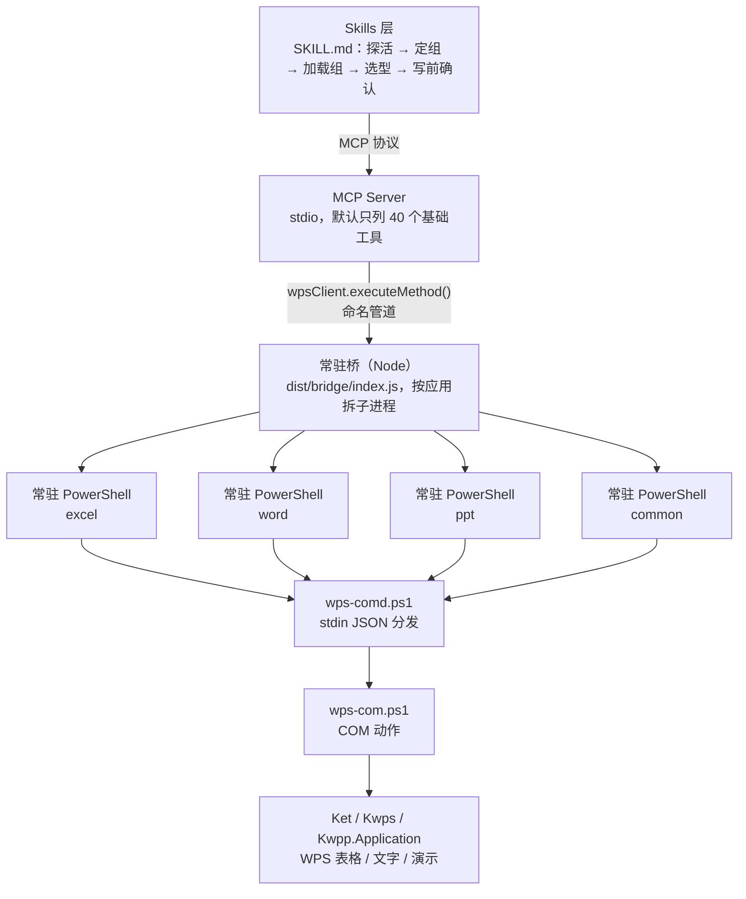

# WPS Office 多面手 MCP

**简体中文** | [English](README.en.md)

<!-- AUTO:badges:start -->
[](LICENSE) [](CHANGELOG.md) [](#能力一览) [](#快速开始)
<!-- AUTO:badges:end -->

> 让 AI 直接操控你**正开着**的 WPS 文字 / 表格 / 演示 —— 走 COM 接口真改文档，不是模拟点击。

WPS 的 COM 自动化能力够，但直接丢给模型会踩三个坑：几百个工具撑爆上下文、写到一半失败说不清、近名工具改错地方还不报错。
这个 MCP 把三件事做成**机制**而不是叮嘱：默认只列 40 个其余按需加载、失败前缀写明能不能重试、每个工具带机器可读的读写注解。

## 规模（实测）

<!-- AUTO:tool-stats:start -->
- **306 个工具**（12 个内置 + 294 个专业/组工具）；**默认只列 40 个**（基础档，按需加载 —— 口径与校验见 `scripts/manual/basic-tier-verify.js`）
- 分布（按工具组，内置计入对应组）：通用 25（含 core）/ Word 70 / Excel 95 / PPT 116
- 注解（实测）：只读 53 / 破坏性 34 / 非幂等 115，覆盖 306/306
<!-- AUTO:tool-stats:end -->

- 配套 skill `wps-multitool`：把「探活 → 定组 → 加载组 → 选型读反例 → 写前确认」固化成默认链路
  （源码在 `wps-office-mcp/skills/wps-multitool/`，安装到 AI 助手的 skills 目录）
- 仅支持 Windows（WPS 的 COM 自动化只在 Windows 可用）
- 走**常驻桥进程**：冷启动约 5 秒，之后每次调用 2~3ms（一应用一进程，互不阻塞）

## 架构



## 能力一览

计数由 `scripts/manual/gen-doc-stats.js` 从注册表生成，勿手改（CI 有 diff 门禁）。
口径与上方统计区一致：内置工具计入对应应用组（core 计入通用），故“内置”行不叠加：

<!-- AUTO:tool-table:start -->
| 应用 | 工具数 | 主要能力 |
|------|--------|---------|
| Excel | 95 | 公式/数据/图表/透视表/工作表/格式/工作簿/行列/批注保护/图片导出 |
| Word | 70 | 格式/内容/文档管理/页眉页脚/批注/书签/表格/模板填写/学术排版/修订/索引/交叉引用 |
| PPT | 116 | 幻灯片/形状/图片/表格/美化/动画/图表/3D/数据可视化/图片导出 |
| 通用 | 25 | 保存/连接检测/文本选取/格式转换/工具组管理/意图路由/批量执行 |
| 内置 | 12（已计入上方各组） | 连接检查/万能方法调用/数据缓存 |
<!-- AUTO:tool-table:end -->

## 快速开始

<details>
<summary><b>6 步安装（点击展开）</b></summary>

### 步骤1: 克隆项目

```bash
git clone https://github.com/forkgo430/wps-multitool-mcp.git
cd wps-multitool-mcp
```

### 步骤2: 安装依赖并编译

```bash
cd wps-office-mcp
npm install
npm run build
cd ..
```

### 步骤3: 配置 MCP Server

将以下配置写入对应文件，注意把路径替换为项目实际绝对路径。

**Claude Code** — 写入 `~/.claude/settings.json`：

```json
{
  "mcpServers": {
    "wps-multitool-mcp": {
      "command": "node",
      "args": ["/你的路径/wps-multitool-mcp/wps-office-mcp/dist/index.js"]
    }
  }
}
```

**Cursor** — 写入项目根目录 `.cursor/mcp.json`：

```json
{
  "mcpServers": {
    "wps-multitool-mcp": {
      "command": "node",
      "args": ["/你的路径/wps-multitool-mcp/wps-office-mcp/dist/index.js"]
    }
  }
}
```

**OpenAI Codex CLI** — 写入 `~/.codex/config.toml`：

```toml
[mcp_servers.wps-multitool-mcp]
command = "node"
args = ["/你的路径/wps-multitool-mcp/wps-office-mcp/dist/index.js"]
```

或命令行注册：`codex mcp add wps-multitool-mcp -- node /你的路径/wps-multitool-mcp/wps-office-mcp/dist/index.js`

**Augment / 其他 MCP 兼容 IDE** — 参考各 IDE 的 MCP 配置文档，使用相同的 command 与 args。
本项目是标准 stdio 实现（spec 2025-11-25），与所有 MCP 一等客户端（Claude Code / Cursor / Codex CLI / GitHub Copilot CLI / Windsurf 等）兼容。

### 步骤4: 安装 WPS 加载项

⚠️ 需要人工操作（AI 无法直接操作 WPS 应用）：

```powershell
powershell -ExecutionPolicy Bypass -File scripts/install.ps1
```

⚠️ 安装后必须重启 WPS Office 才能生效。

### 步骤5: 安装 skill（仅 Claude Code 需要）

```bash
mkdir -p ~/.claude/skills
ln -sf "$(pwd)/wps-office-mcp/skills/wps-multitool" ~/.claude/skills/wps-multitool
```

### 步骤6: 验证安装

```powershell
cd wps-office-mcp
npm run verify
# 应看到 14 项验证门禁全绿（含 Word/Excel 真机能力探测）
```

</details>

## 设计取舍

这几个决定看起来"反直觉"，但都是为了不把模型和用户坑进去：

1. **默认只列 40 个工具** —— 上下文是最贵的资源。几百个工具一次性塞进去，既贵又稀释注意力；
   其余工具靠 `wps_search_tools` 搜、`wps_load_tool_group` 拉。**"工具不存在"通常不是没能力，是组没加载。**
2. **"部分成功"是第三态** —— COM 不是事务，天然会做一半（某个属性不支持、某个锚点插不上）。
   算失败 → 用户以为没变、重做一遍；算成功 → 用户以为全好。所以成功之外单独给 `warnings`，
   渲染成「做完了，但有 N 处没按预期」。
3. **失败不自动重试** —— 分不清"请求没执行"和"执行了一半"时，重放就是执行两次。
   失败文本的方括号前缀直接写明：`[可重试]` 可以退避重发，`[勿重试·可能已执行一半]` 必须先读回来看结果。
4. **近名工具必须写反例** —— 本工具集有 6 个 background、5 个 animation、2 个目录……
   选错不会报错，只会把事情改到别处。所以搜索结果里的 `notFor` 是必读项，不是装饰。

## 故障排除

| 问题 | 解决方案 |
|------|---------|
| MCP 连接失败 | 确认 `npm install && npm run build` 已执行，检查 `dist/index.js` 存在 |
| WPS 未响应 | 重启 WPS Office，确认加载项已安装 |
| "arguments error" | 重新运行安装脚本，重启 WPS |
| Linux 找不到插件 | 本项目仅支持 Windows（WPS 的 COM 自动化只在 Windows 可用） |
| 工具调用返回 null | 确认 WPS 中已打开对应类型的文档 |
| 其他问题 | 到 GitHub 仓库提 issue：https://github.com/forkgo430/wps-multitool-mcp/issues |

## 许可

MIT
