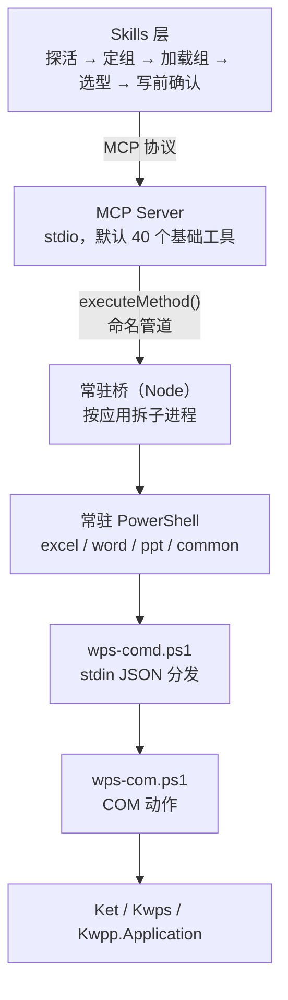

# WPS Office 多面手 MCP

**简体中文** | [English](README.en.md)

<!-- AUTO:badges:start -->
[](https://github.com/forkgo430/wps-multitool-mcp/actions/workflows/ci.yml) [](LICENSE) [](https://www.npmjs.com/package/wps-multitool-mcp) [](https://github.com/forkgo430/wps-multitool-mcp/releases) [](#能力一览) [](#安装)
<!-- AUTO:badges:end -->

> 让 AI 直接操控你**正开着**的 WPS 文字 / 表格 / 演示。

<sub>作者 / 维护者：**赢容** · [npm](https://www.npmjs.com/package/wps-multitool-mcp) · [Release](https://github.com/forkgo430/wps-multitool-mcp/releases)</sub>

## 30 秒上手

```powershell
npx -y wps-multitool-mcp
```

```json
{
  "mcpServers": {
    "wps-multitool-mcp": {
      "command": "npx",
      "args": ["-y", "wps-multitool-mcp"]
    }
  }
}
```

重启客户端，打开一个 WPS 文档，然后直接说：

> 把这份合同的金额段落加粗，并在末尾补一段风险提示

想要侧边面板（快照 / 撤销 / 状态），再装加载项：

```powershell
irm https://cdn.jsdelivr.net/gh/forkgo430/wps-multitool-mcp@main/scripts/install.ps1 | iex
```

## 为什么不是"又一个 WPS 插件"

| 坑 | 机制 |
|---|---|
| 几百个工具塞爆上下文 | 默认只列 40 个，其余 `wps_search_tools` 搜、`wps_load_tool_group` 拉 |
| 写到一半失败，说不清到底改没改 | `warnings` 第三态：做完了，但有 N 处没按预期 |
| 近名工具选错，不报错，改到别处 | 每个工具带 `notFor` 反例，搜索命中必读 |

COM 不是事务，所以**失败带重试标签**：`[可重试]` 直接重发，`[勿重试·可能已执行一半]` 先读回来再决定。

## 规模

<!-- AUTO:tool-stats:start -->
- **306 个工具**（12 个内置 + 294 个专业/组工具）；**默认只列 40 个**（基础档，按需加载 —— 口径与校验见 `scripts/manual/basic-tier-verify.js`）
- 分布（按工具组，内置计入对应组）：通用 25（含 core）/ Word 70 / Excel 95 / PPT 116
- 注解（实测）：只读 53 / 破坏性 34 / 非幂等 115，覆盖 306/306
<!-- AUTO:tool-stats:end -->

## 架构



冷启动约 5 秒，之后每次调用 2~3ms。一应用一进程，WPS 文字卡死不会堵住表格。

## 能力一览

计数由 `scripts/manual/gen-doc-stats.js` 从注册表生成，勿手改（CI 有 diff 门禁）。
口径与上方统计区一致：内置工具计入对应应用组（core 计入通用），故“内置”行不叠加：

<!-- AUTO:tool-table:start -->
| 应用 | 工具数 | 主要能力 |
|------|--------|---------|
| Excel | 95 | 公式/数据/图表/透视表/工作表/格式/工作簿/行列/批注保护/图片导出 |
| Word | 70 | 格式/内容/文档管理/页眉页脚/批注/书签/表格/模板填写/学术排版/修订/索引/交叉引用 |
| PPT | 116 | 幻灯片/形状/图片/表格/美化/动画/图表/3D/数据可视化/图片导出 |
| 通用 | 25 | 保存/连接检测/文本选取/格式转换/工具组管理/意图路由/批量执行 |
| 内置 | 12（已计入上方各组） | 连接检查/万能方法调用/数据缓存 |
<!-- AUTO:tool-table:end -->

## 安装

<details>
<summary><b>环境要求</b></summary>

| 要求 | 说明 |
|------|------|
| Windows 10 / 11 | WPS 的 COM 自动化只在 Windows 可用 |
| WPS Office 2019+（实测 12.1） | 装哪个盘都行 |
| Node.js ≥ 18 | 构建与运行 MCP Server |
| 一个 MCP 客户端 | Claude Code / Cursor / Codex CLI / CodeBuddy / WorkBuddy 等 |

</details>

<details>
<summary><b>完整安装（一键脚本 + 加载项 + skill）</b></summary>

```powershell
irm https://cdn.jsdelivr.net/gh/forkgo430/wps-multitool-mcp@main/scripts/install.ps1 | iex
```

自动完成：检查环境 → 拉取项目 → 装依赖并编译 → 部署 WPS 加载项 → 安装 skill → 打印 MCP 配置。
装完重启 WPS 和客户端，把配置粘进去即可。需要能访问 GitHub；否则按下面手动装。

</details>

<details>
<summary><b>手动安装</b></summary>

```bash
git clone https://github.com/forkgo430/wps-multitool-mcp.git
cd wps-multitool-mcp
powershell -ExecutionPolicy Bypass -File scripts/install.ps1
```

脚本支持 `-DryRun`（只检查不改动）、`-Dev`（加载项用符号链接，改源码即时生效）、`-InstallDir`（指定目录）。

</details>

<details>
<summary><b>只配 MCP，不装加载项</b></summary>

> 下面路径里出现两次 `wps-multitool-mcp` 是正常的：外层是 clone 出来的目录，内层是项目子目录。
> 不确定就用一键安装脚本，它会把你机器上的真实路径打印出来。

**Claude Code** — `~/.claude/settings.json`：

```json
{
  "mcpServers": {
    "wps-multitool-mcp": {
      "command": "node",
      "args": ["/你的路径/wps-multitool-mcp/wps-multitool-mcp/dist/index.js"]
    }
  }
}
```

**Cursor** — `.cursor/mcp.json`；**OpenAI Codex CLI** — `~/.codex/config.toml`：

```toml
[mcp_servers.wps-multitool-mcp]
command = "node"
args = ["/你的路径/wps-multitool-mcp/wps-multitool-mcp/dist/index.js"]
```

标准 stdio 实现（spec 2025-11-25），任何 MCP 客户端都能接。

</details>

## 故障排除

| 问题 | 解决方案 |
|------|---------|
| MCP 连接失败 | 确认 `dist/index.js` 存在，客户端路径正确 |
| WPS 未响应 | 重启 WPS，确认 `%APPDATA%\kingsoft\wps\jsaddons\wps-claude-addon_` 存在 |
| "arguments error" | 重跑 `scripts/install.ps1`，重启 WPS |
| 一键安装卡住 | 访问不了 GitHub，改用「手动安装」 |
| 其他问题 | [提 issue](https://github.com/forkgo430/wps-multitool-mcp/issues) |

## 许可

MIT
