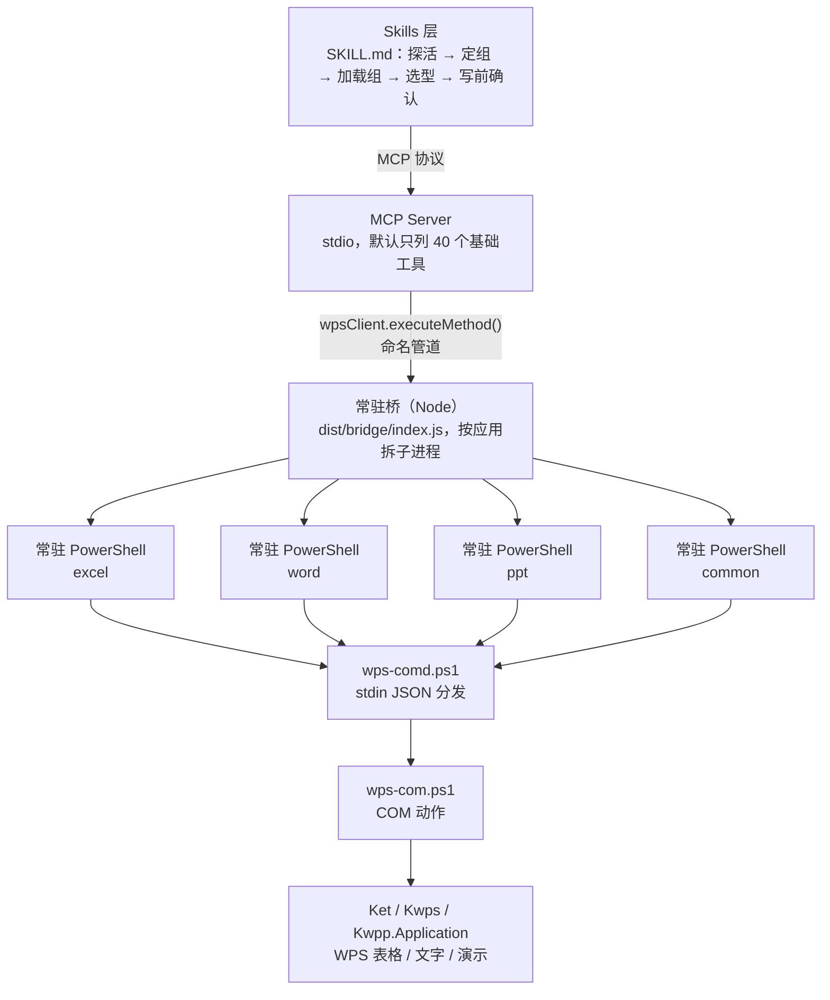

# WPS Office 多面手 MCP

**简体中文** | [English](README.en.md)

<!-- AUTO:badges:start -->
[](https://github.com/forkgo430/wps-multitool-mcp/actions/workflows/ci.yml) [](LICENSE) [](https://www.npmjs.com/package/wps-multitool-mcp) [](https://github.com/forkgo430/wps-multitool-mcp/releases) [](#能力一览) [](#快速开始)
<!-- AUTO:badges:end -->

> 让 AI 直接操控你**正开着**的 WPS 文字 / 表格 / 演示 —— 走 COM 接口真改文档，不是模拟点击。

<sub>作者 / 维护者：**赢容** · [npm](https://www.npmjs.com/package/wps-multitool-mcp) · [Release](https://github.com/forkgo430/wps-multitool-mcp/releases)</sub>

WPS 的 COM 自动化能力够，但直接丢给模型会踩三个坑：几百个工具撑爆上下文、写到一半失败说不清、近名工具改错地方还不报错。
这个 MCP 把三件事做成**机制**而不是叮嘱：默认只列 40 个其余按需加载、失败前缀写明能不能重试、每个工具带机器可读的读写注解。

## 目录

- [快速开始](#快速开始) · [环境要求](#环境要求) · [能力边界](#能力边界)
- [规模](#规模实测) · [架构](#架构) · [能力一览](#能力一览)
- [设计取舍](#设计取舍) · [故障排除](#故障排除) · [许可](#许可)

## 快速开始

### 方式一：只要 AI 能操控 WPS（最轻，不克隆、不编译）

```powershell
npx -y wps-multitool-mcp
```

已发布到 npm，直接以 MCP stdio 服务运行。写进客户端配置：

```json
{
  "mcpServers": {
    "wps-multitool-mcp": {
      "command": "npx",
      "args": ["-y", "wps-multitool-mcp"]
    }
  }
}
```

这条路径**不含** WPS 里的侧边面板和 skill（不需要它们也能用）；想要面板 / 快照 / 撤销，用方式二。

### 方式二：完整安装（含加载项面板 + skill，推荐）

```powershell
irm https://cdn.jsdelivr.net/gh/forkgo430/wps-multitool-mcp@main/scripts/install.ps1 | iex
```

自动完成：检查环境 → 拉取项目 → 装依赖并编译 → 部署 WPS 加载项 → 安装 skill → 打印 MCP 配置。
装完**重启 WPS 和你的 AI 客户端**，把打印出来的配置粘进客户端即可。

<details>
<summary><b>手动安装（网络受限 / 想自己控制每一步）</b></summary>

```bash
git clone https://github.com/forkgo430/wps-multitool-mcp.git
cd wps-multitool-mcp
powershell -ExecutionPolicy Bypass -File scripts/install.ps1
```

脚本干的事和上面一样。也可以只跑其中几步，见脚本里的 `-DryRun`（只检查不修改）、`-Dev`（加载项用符号链接，改源码即时生效）。

</details>

<details>
<summary><b>只配置 MCP、不装加载项（加载项只影响 WPS 里的侧边面板）</b></summary>

**Claude Code** — `~/.claude/settings.json`：

```json
{
  "mcpServers": {
    "wps-multitool-mcp": {
      "command": "node",
      "args": ["/你的路径/wps-multitool-mcp/wps-office-mcp/dist/index.js"]
    }
  }
}
```

**Cursor** — `.cursor/mcp.json`；**OpenAI Codex CLI** — `~/.codex/config.toml`：

```toml
[mcp_servers.wps-multitool-mcp]
command = "node"
args = ["/你的路径/wps-multitool-mcp/wps-office-mcp/dist/index.js"]
```

**其他 MCP 客户端** — 同一个 `command` / `args`。本项目是标准 stdio 实现（spec 2025-11-25）。

</details>

## 环境要求

| 要求 | 说明 |
|------|------|
| **Windows 10 / 11** | WPS 的 COM 自动化只在 Windows 可用，没有 macOS / Linux 版本 |
| **WPS Office 2019+**（实测 12.1） | 加载项与 COM 接口都依赖它；装在哪个盘都行 |
| **Node.js ≥ 18** | 构建与运行 MCP Server |
| **一个 MCP 客户端** | Claude Code / Cursor / Codex CLI / CodeBuddy / WorkBuddy 等 |
| 网络 | 一键安装需要能访问 GitHub（国内需代理）；否则用「手动安装」 |

## 能力边界

诚实地划一下范围，避免预期错位：

| 能做 | 不能做 |
|------|--------|
| 读写**当前打开**的 WPS 文档：文字、表格、演示 | 不操作云端文档；文件没打开会先让你打开，不会偷偷开一堆窗口 |
| 排版与格式：样式、字体、段落、表格、图表、页眉页脚、目录 | **没有撤销 / 回滚**（COM 写入不是事务，重要操作前先存快照） |
| 表格数据读写、公式、透视表、条件格式、图片导出 | 不做**自动重试**：分不清"没执行"和"执行了一半"，失败前缀会写明能不能重发 |
| 批注 / 书签 / 修订 / 交叉引用 / 索引 / 学术排版 | 不保证每个 WPS 版本的每个 COM 属性都支持——不支持的走 `warnings`，不假装成功 |
| 一次组合 1~3 步的连续操作（`wps_common_batch`） | 不做长时间后台任务，也不跨机器操作 |

## 规模（实测）

<!-- AUTO:tool-stats:start -->
- **306 个工具**（12 个内置 + 294 个专业/组工具）；**默认只列 40 个**（基础档，按需加载 —— 口径与校验见 `scripts/manual/basic-tier-verify.js`）
- 分布（按工具组，内置计入对应组）：通用 25（含 core）/ Word 70 / Excel 95 / PPT 116
- 注解（实测）：只读 53 / 破坏性 34 / 非幂等 115，覆盖 306/306
<!-- AUTO:tool-stats:end -->

- 配套 skill `wps-multitool`：把「探活 → 定组 → 加载组 → 选型读反例 → 写前确认」固化成默认链路
  （源码在 `wps-office-mcp/skills/wps-multitool/`，一键安装会装进客户端的 skills 目录）
- 走**常驻桥进程**：冷启动约 5 秒，之后每次调用 2~3ms（一应用一进程，互不阻塞）

## 架构



## 能力一览

计数由 `scripts/manual/gen-doc-stats.js` 从注册表生成，勿手改（CI 有 diff 门禁）。
口径与上方统计区一致：内置工具计入对应应用组（core 计入通用），故“内置”行不叠加：

<!-- AUTO:tool-table:start -->
| 应用 | 工具数 | 主要能力 |
|------|--------|---------|
| Excel | 95 | 公式/数据/图表/透视表/工作表/格式/工作簿/行列/批注保护/图片导出 |
| Word | 70 | 格式/内容/文档管理/页眉页脚/批注/书签/表格/模板填写/学术排版/修订/索引/交叉引用 |
| PPT | 116 | 幻灯片/形状/图片/表格/美化/动画/图表/3D/数据可视化/图片导出 |
| 通用 | 25 | 保存/连接检测/文本选取/格式转换/工具组管理/意图路由/批量执行 |
| 内置 | 12（已计入上方各组） | 连接检查/万能方法调用/数据缓存 |
<!-- AUTO:tool-table:end -->

## 设计取舍

这几个决定看起来"反直觉"，但都是为了不把模型和用户坑进去：

1. **默认只列 40 个工具** —— 上下文是最贵的资源。几百个工具一次性塞进去，既贵又稀释注意力；
   其余工具靠 `wps_search_tools` 搜、`wps_load_tool_group` 拉。**"工具不存在"通常不是没能力，是组没加载。**
2. **"部分成功"是第三态** —— COM 不是事务，天然会做一半（某个属性不支持、某个锚点插不上）。
   算失败 → 用户以为没变、重做一遍；算成功 → 用户以为全好。所以成功之外单独给 `warnings`，
   渲染成「做完了，但有 N 处没按预期」。
3. **失败不自动重试** —— 分不清"请求没执行"和"执行了一半"时，重放就是执行两次。
   失败文本的方括号前缀直接写明：`[可重试]` 可以退避重发，`[勿重试·可能已执行一半]` 必须先读回来看结果。
4. **近名工具必须写反例** —— 本工具集有 6 个 background、5 个 animation、2 个目录……
   选错不会报错，只会把事情改到别处。所以搜索结果里的 `notFor` 是必读项，不是装饰。

## 故障排除

| 问题 | 解决方案 |
|------|---------|
| MCP 连接失败 | 确认已构建（`wps-office-mcp/dist/index.js` 存在），客户端配置路径正确 |
| WPS 未响应 | 重启 WPS Office，确认加载项已安装（`%APPDATA%\kingsoft\wps\jsaddons\wps-claude-addon_`） |
| "arguments error" | 重跑 `scripts/install.ps1`，然后重启 WPS |
| 一键安装卡在下载 | 访问不了 GitHub；挂代理，或改用「手动安装」 |
| 工具调用返回 null | 确认 WPS 中已打开对应类型的文档 |
| 其他问题 | 到 GitHub 仓库提 issue：https://github.com/forkgo430/wps-multitool-mcp/issues |

## 许可

MIT
